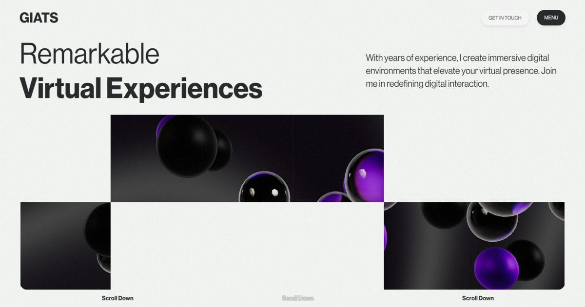

# DUCNGVAN — Software Engineer Portfolio

Personal portfolio website of **Nguyễn Văn Đức** (Nguyen Van Duc), Software Engineering student at Greenwich Vietnam & Full-Stack Developer.

This project is built on top of the award-winning architecture of [giats-portfolio](https://github.com/Giats2498/giats-portfolio) by Evangelos Giatsidis (CSS Design Awards WOTD, Awwwards HM, GSAP Site of the Day), customized with Nguyen Van Duc's biography, academic honors, and featured projects.

---

## 👨‍💻 About Me

- **Name:** Nguyễn Văn Đức (Duc)
- **Role:** Software Engineering Student & Full-Stack Developer
- **University:** University of Greenwich (Greenwich Vietnam - Da Nang)
- **Email:** [ducnva.wk@gmail.com](mailto:ducnva.wk@gmail.com)
- **Location:** Da Nang, Vietnam
- **Honors:**
  - 🏆 **Top 3 Excellent Students 2024** - Greenwich Vietnam (Decision 157/QĐ-FPTUDN)
  - 🥇 **Best Student ICM 2026** - Module COMP1643 (Decision 181 QH-PPTUDN)
  - 🥈 **2nd Place Impact Innovation Bootcamp 2025** - Hospital 199

---

## 🧠 Architecture & Tech Stack

- **Framework:** Next.js 14 (Pages Router)
- **3D & Shaders:** Three.js, React Three Fiber, GLSL Shaders (Dynamic background shader + fluid interactive simulation)
- **Animation:** GSAP (ScrollTrigger, Flip), Lenis Smooth Scroll
- **State Management:** Zustand
- **Styling:** SCSS Modules + Custom CSS Grid
- **Deployment:** Vercel / GitHub Pages

---

## 🚀 Getting Started

```bash
# Install dependencies
npm install --legacy-peer-deps

# Start development server on port 5173
npm run dev

# Build for production
npm run build
```

---

## 📸 Assets & Privacy Notice

- Personal and client-related visuals (e.g., images, logos, portraits) have been **blurred, replaced, or omitted** to respect privacy and copyright.
- The full visual experience is available at [giats.me](https://giats.me).
- **Do not reuse images or branding without permission.**

---

## 📄 License & Attribution

This project is licensed under the **MIT License (with attribution required)**.

> If you use this code or parts of it, **credit is required**:
>
> _"Original portfolio design and development by Evangelos Giatsidis — [giats.me](https://giats.me)"_

You are welcome to learn from or build upon this project, but **do not claim it as your own or use it commercially without permission.**

---

## 📬 Contact

- 📧 Email: [vaggelisgiats@gmail.com](mailto:vaggelisgiats@gmail.com)
- 💼 LinkedIn: [linkedin.com/in/giats](https://www.linkedin.com/in/giats/)
- 🌐 Website: [giats.me](https://giats.me)
- 🐦 X (Twitter): [@Giats\_](https://x.com/Giats_)

---

Thank you for checking out my portfolio. I hope this project inspires or helps you in your own creative journey.
